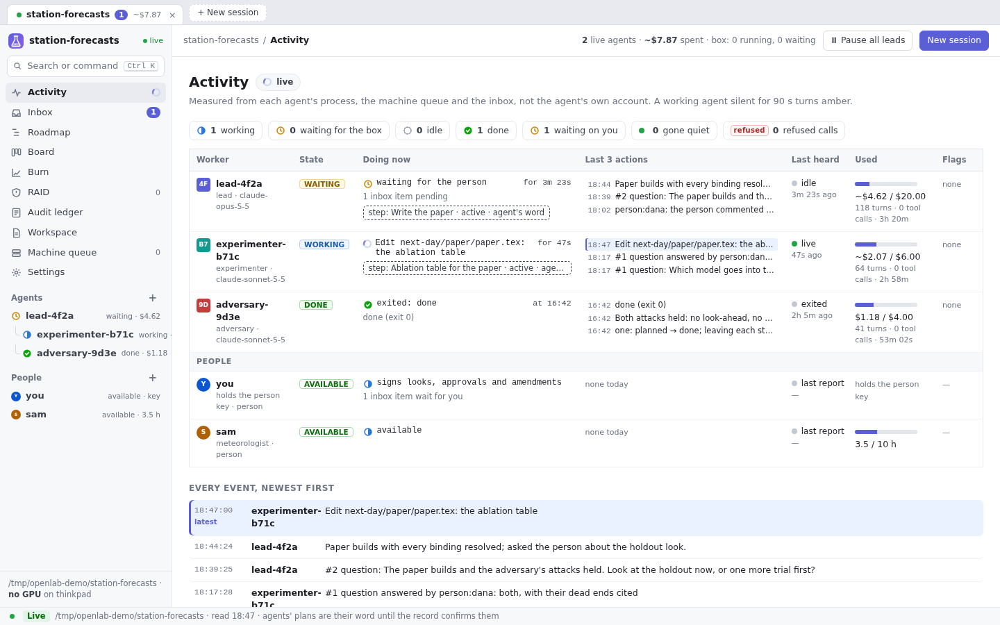
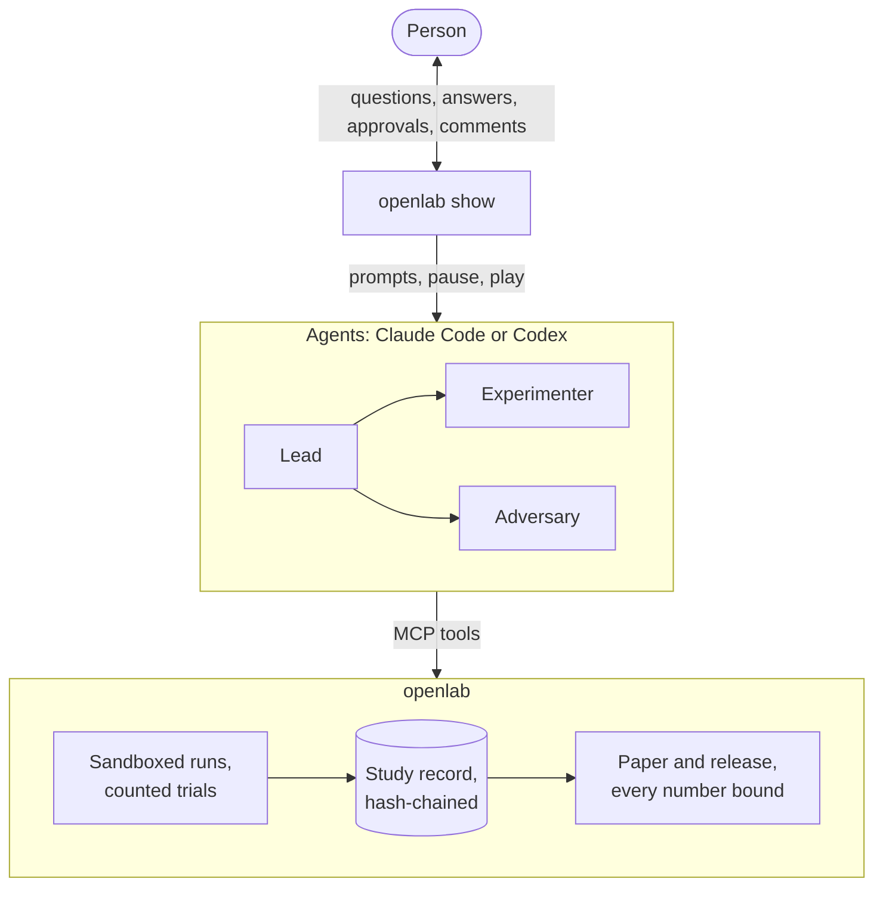
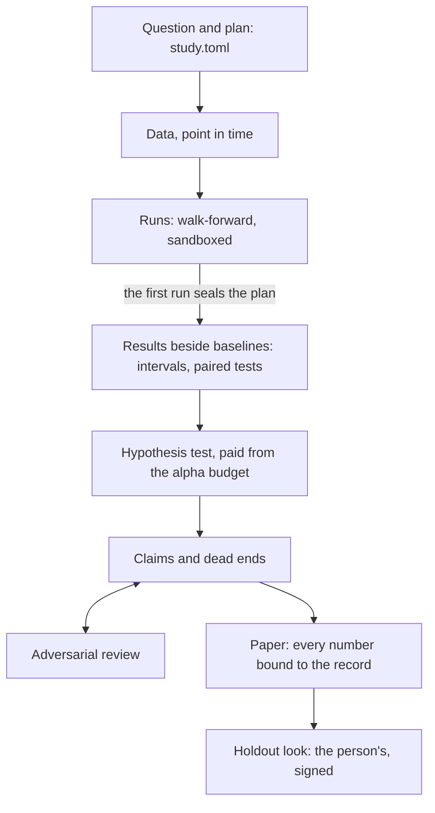
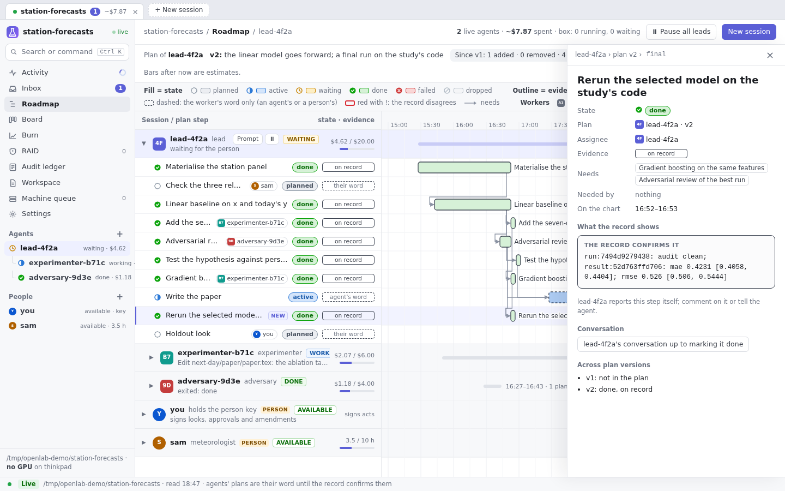
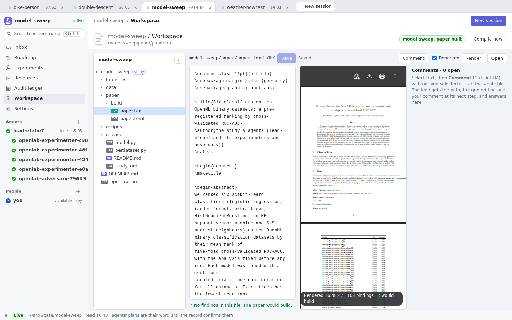
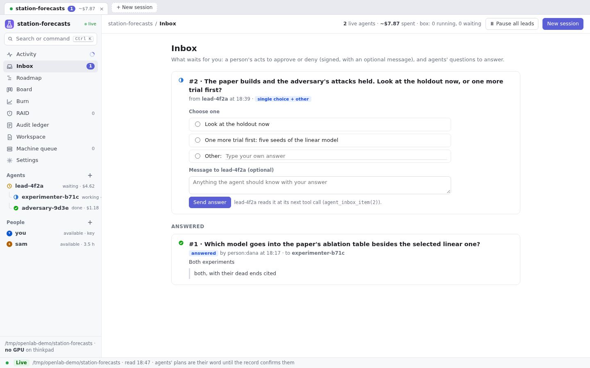
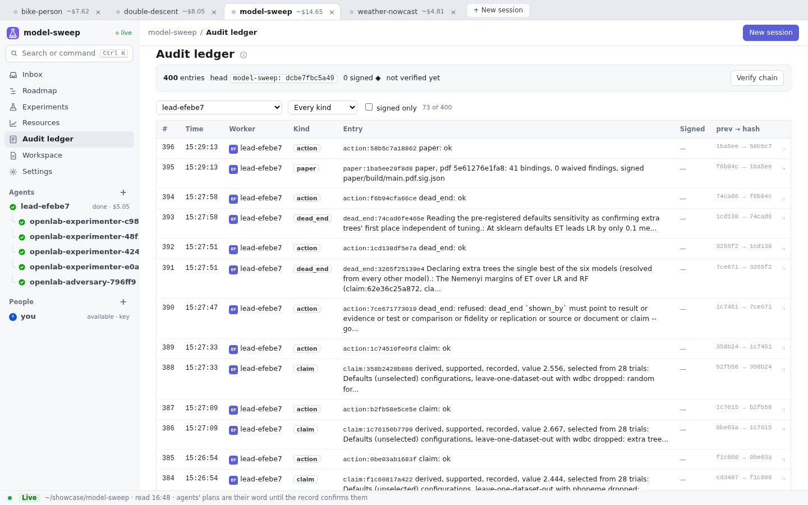

<p align="center"></p>

# Openlab

**Supervise your research agents, and keep a record they cannot bend.**

Openlab is a control plane and a study record for the Claude Code and Codex agents you already run for research.

- **One tree, one budget, one inbox.** Claude Code alone gives you sessions in terminals. With openlab, every
  session, sub-agent and spawned agent is in one tree with its spend and its budget, and you can pause or stop
  any of them, or prompt a lead while it works.
- **Trials are counted, the holdout is yours.** Alone, an agent can rerun until a number looks good and edit the plan
  afterwards. With openlab, the first run seals the plan, every distinct run is a counted trial, and only you can
  score the held-out rows, with a look you sign.
- **Every number traced.** Alone, the write-up prints whatever the agent typed. With openlab, each number in the
  paper is bound to a recorded run or to a quote checked on its page.

[](https://github.com/daniel-debrun/openlab/actions/workflows/test.yml)

[](https://github.com/daniel-debrun/openlab/blob/HEAD/LICENSE)



## How it works

The person asks the question and keeps the decisions that matter. The agents do the work through openlab's tools,
and openlab keeps the record they cannot rewrite.



A study moves from a question to a holdout look the person signs. Every step leaves an entry on the record.



## Status and requirements

- **Alpha.** The record format may change between versions.
- **Linux with bubblewrap (`bwrap`)** for the sandbox. Elsewhere (macOS, containers that forbid user namespaces),
  runs still happen and are recorded as `unsandboxed`.
- **Python 3.10 or later.**
- **A `claude` or `codex` login** for agents. Openlab holds no model key and runs no model of its own.
- **`latexmk`** only to build a paper.

## Install

```
pip install "openlab-research[study]"   # [study]: scikit-learn, mlflow, matplotlib, which `study run` needs
openlab doctor                          # what works here, and the one line that fixes what does not
```

The package is `openlab-research` on PyPI; the command and the Python package are `openlab`. From a checkout:
`git clone https://github.com/daniel-debrun/openlab` and `pip install -e "./openlab[study]"`. More in
[docs/install.md](docs/install.md).

## Quickstart: 60 seconds, no key, no agent

Three words come up everywhere:

- **Seal.** The first run freezes `study.toml`. After that, an edit is an amendment with a reason, and edits to
  the fields that protect the result (split, budget, primary metric and a few more) need you.
- **Trial.** A distinct research run, counted against `budget.trials`. An identical rerun is cached and free.
- **Look.** One scoring of the held-out rows. Only you can spend one, counted against `budget.holdout_looks`.

A toy study on generated data (transcripts trimmed):

```
$ mkdir research && cd research
$ openlab study new demo --template temporal
new study demo in ~/research/demo

$ openlab study materialise demo
dataset:c84fbafa7e11  panel: 2192 rows, sha d74309e84d36

$ openlab study run demo
trial 1 of 20: the study's first run
result:c0b3d7737e2a  audit: clean  scored rows: 1340
  mae            0.4231 [0.4058, 0.4404]
  baseline persistence: mae 0.9021 [0.8501, 0.9576], rmse 1.145 [1.079, 1.212]
  model - persistence (mae): -0.479 [-0.5308, -0.433], p 0.002, better: model
  ...

$ openlab study run demo                       # unchanged: cached
cached: no trial spent (key a51817437fc1): the code, data, spec and environment of run:018f24f52c01
  ...

$ openlab study status demo
sealed 2026-10-08T20:00:29-04:00 (plan:03ee261d54b1): study.toml is frozen; an edit needs `openlab study amend`
trials 1 of 20, holdout looks 0 of 1 (a look scores the held-out rows once; a person's act)
```

A study is a folder: `study.toml` (the plan), `model.py` (your code), `recipes/` (the scripts that make the data),
`data/`, and `.openlab/` (the record). [The first five minutes](docs/first-five-minutes.md) walks on from here to a
variant, a refusal, a claim and a holdout look.

## Connect your agents

```
cd research
openlab init --claude      # Claude Code hooks, five role agents, .mcp.json, openlab.toml
openlab init --codex       # or: an AGENTS.md section and the MCP snippet for ~/.codex/config.toml
```

Open two tmux panes in `research/`: `claude` in one, `openlab watch` in the other. Every Claude Code session and
sub-agent you start in this folder joins the tree in `openlab watch`, with its spend, its last action and its flags
(STUCK, LOOP, OVER, WAITING, BYPASS). An agent that needs you files a request in `openlab inbox` and carries on.

`openlab show --root .` serves the live view in your browser (on 127.0.0.1, behind a token): what each agent is doing,
its plan against the record, the inbox, burn, RAID, the audit ledger, and the Workspace: the research's files, each
study's paper and README edited beside their rendering, and comments on any file for the lead. Each lead's row has:

- **Prompt.** A short chat with the lead. **Ask now (btw)** answers in seconds from a fork of the lead's session while
  the lead keeps working, like Claude Code's `/btw`. **Tell the lead** reaches the lead itself at its next tool
  call; it answers and changes course if asked. Only leads take prompts; the agents under a lead hear only from it.
- **⏸ / ▶.** Pause or resume the lead and the agents under it. The header has **Pause all leads / Play all leads**.
  Pausing is not signed; resuming is signed with your passphrase.

From a shell: `openlab agent tell LEAD "..."`, `openlab agent pause ID --reason ...`, `openlab agent resume ID --reason ...`,
`openlab agent stop ID --reason ...`. Telling an agent that works under a lead is refused; tell its lead. More in
[docs/supervising-agents.md](docs/supervising-agents.md) and [docs/show.md](docs/show.md).

### openlab show

**Roadmap.** Each agent's plan as a Gantt chart. A step's outline is the record's evidence for it: solid when a
record id confirms it, dashed while it is the agent's word. A step opens the agent's conversation up to the call
that marked it done.



**Workspace.** The research's files. The paper's LaTeX beside the PDF it builds to, with every number bound to the
record; a comment on any text or file goes to the lead, which answers in the thread.



**Inbox.** The agents' questions and requests, answered with a choice, an answer of the person's own and a message.



**Audit ledger.** The study record itself, newest first, each entry's hash covering the one before it.



The screens come from the demo research that `scripts/demo_workspace.py` builds: a real study, its record and its
paper, with the agents' activity staged around them. `scripts/screenshots.py` takes them again.

## Your person key

The person key is an Ed25519 key, encrypted with your passphrase, that signs your person acts: a holdout look, an
approval, a protected amendment, an inbox decision, resuming a paused agent. An agent on your account can read the
encrypted file but cannot sign without the passphrase.

```
openlab person init        # once per machine: a handle and a passphrase
openlab person pin         # pin the key's fingerprint in this workspace
```

Both ask on an interactive terminal, so run them yourself; the hooks refuse them to agents. You first need the key
at your first holdout look or approval (or to resume a paused agent). Keep the fingerprint (`openlab person show`) somewhere no agent can write.

## Three ways to use it

### A literature review with checked quotes

The protocol (question, indexes, queries, criteria, coverage floor) is sealed by the first search. Every screening
decision names its agent, and a number is accepted only if its quote is on the page it cites and writes the number.

```
$ openlab study new lit --template review       # edit [review] in lit/study.toml
$ openlab study discover lit
$ openlab study extract lit SOURCE --page 8 --section 5.1 --quote "..." --fields '{"crps": 0.88}'
error: the quote is not on page 8
meaning: it is on page 9
fix: quote the page as study_fetch_text gives it (layout=true for a table row)
```

See [docs/literature-review.md](docs/literature-review.md).

### Paper to code, verified

Give it the paper. A planning agent drafts the replication plan: the methods, the numbers to check (each quoted
from its page), the metric and a tolerance justified from the paper. Openlab lints it, you approve it with your
passphrase, and a builder agent rebuilds the baselines first, then the paper's method. A claim stays inconclusive
while a baseline it depends on is not rebuilt within tolerance.

```
$ openlab replicate 1805.09091
approve this plan and start the build? [y/N] y
passphrase to sign:
building with replicator-8b7e04 (claude, $5, 120 min)
$ openlab replicate status 1805.09091
```

See [Paper to code](docs/features.md#paper-to-code) for the manual form, units and coverage.

### Research from a prompt

You write a paragraph. An agent (or you) turns it into a proposal: hypotheses, each with a falsifier, and branches,
each with a budget, a stop rule and a kill criterion. Your approval seals the plan, and a lead agent runs it as a
tree of agents, one per branch.

```
$ openlab propose new lagx --from prompt.txt --mode temporal --budget-usd 1 --minutes 30
$ openlab propose lint lagx
$ openlab propose approve lagx --reason "the plan to run"     # yours: asks for your passphrase
$ openlab propose execute lagx
$ openlab propose status lagx
```

See [docs/research-from-prompt.md](docs/research-from-prompt.md).

## What openlab guarantees

Each guarantee is checked when something is written. A write that breaks one is refused with an error, its
meaning and a fix; it is never stored and flagged later.

| Guarantee | What enforces it |
|---|---|
| The plan comes first | the first run seals `study.toml`; a later edit stops the next run until it is recorded as an amendment, and the protected fields need a signed person amendment |
| Features cannot see the future | a view holds only rows known at `t`; the truncation audit reruns sampled steps holding only the past |
| Research runs never load holdout rows | the runner stages research rows only; the sandbox (no network, `.openlab/` and `data/` masked) runs a snapshot of the code |
| Every trial is counted | a run's key hashes its code, data, spec and packages; an identical key is cached; past the budget a run is refused; a second study on the same data cannot start a fresh count |
| Only a person looks at the holdout | a look is a signed person node, numbered and bound to the code, data and spec hashes |
| Numbers are computed, not typed | a claim's verdict and level are computed from what it rests on; a pick from several trials says "selected from N trials" |
| Evidence is where it says | an extracted quote must be on its page and contain its numbers |
| The paper says what the record says | the build refuses an unbound number, "significant" without a rejecting test, a stale binding, a quote not in its source |
| The record is not quietly edited | append-only SQLite, hash-chained over every node; `openlab study verify` recomputes the chain and every signature |
| An instrument is what was registered | a version is the sha of its snapshot, entry and environment fingerprint, registered by the person's signature; every run re-checks it and is recorded with its hashes ([docs/instruments.md](docs/instruments.md)) |
| An experiment runs only what the person started | its start is a signed person node over the spec; openlab counts its passes, applies its stop rule and touches only its own crontab lines ([docs/experiments.md](docs/experiments.md)) |

The record is tamper-evident, not tamper-proof: whoever controls the machine can rebuild a whole record under a new
key. [docs/guards.md](docs/guards.md) has every guarantee, the trust levels and the threat model.

## How it compares

| Tool | What it is good at | How openlab relates |
|---|---|---|
| Claude Code (or Codex) and git | the agent does the work; git keeps the code's history | openlab keeps both and adds what git does not record: how many runs were tried, who looked at the holdout, and where each number came from |
| MLflow, W&B, DVC | experiment tracking, dashboards, artifact and data versioning | complements: they log what you send them; openlab refuses what breaks the plan. Each run writes to an MLflow model store, and `openlab mirror` mirrors a study's runs to W&B |
| OSF preregistration | a public, time-stamped plan held by a third party | openlab's seal is local and enforced at run time, not held by a third party; the two can be used together |
| AI Scientist, Agent Laboratory | autonomous pipelines from idea to paper, with their own agent loop | openlab runs no agent loop or model of its own and generates no ideas; it supervises your CLI agents and constrains what reaches the paper |
| XScientist | a multi-agent research system that keeps ideas, plans and experiment records as artifacts | openlab's focus is enforcement: refusals at write time, person-signed gates, counted trials |

## More

- [Command reference](docs/cli.md) and [what else is in the box](docs/features.md)
- [Instruments](docs/instruments.md): registered, immutable programs that act outside the sandbox (a broker's paper account, a collector, a CLI)
- [Experiments](docs/experiments.md): a study's instruments on a schedule for a set number of passes, then an agent's conclusion
- [Glossary](docs/GLOSSARY.md), and the agent's contract: [openlab/AGENTS.md](openlab/AGENTS.md)
- [Benchmark mode: MLE-bench](docs/benchmark.md) and [on a server or GPU box](docs/box.md)

## Contributing

See [CONTRIBUTING.md](CONTRIBUTING.md). Report a vulnerability privately; see [SECURITY.md](SECURITY.md).

## License

[PolyForm Shield 1.0.0](LICENSE). Anyone may use, change and share openlab for any purpose, at work too, except to provide a product that competes with it: selling openlab, or a renamed copy of it, is not allowed. Every copy keeps the license and its `Required Notice` line. For other terms, open an issue. Third-party components keep their own licenses ([THIRD_PARTY_NOTICES.md](THIRD_PARTY_NOTICES.md)). To cite openlab, see [CITATION.cff](CITATION.cff).

---

Not affiliated with or endorsed by Anthropic or OpenAI. Claude and Claude Code are trademarks of Anthropic; Codex is a
trademark of OpenAI.
